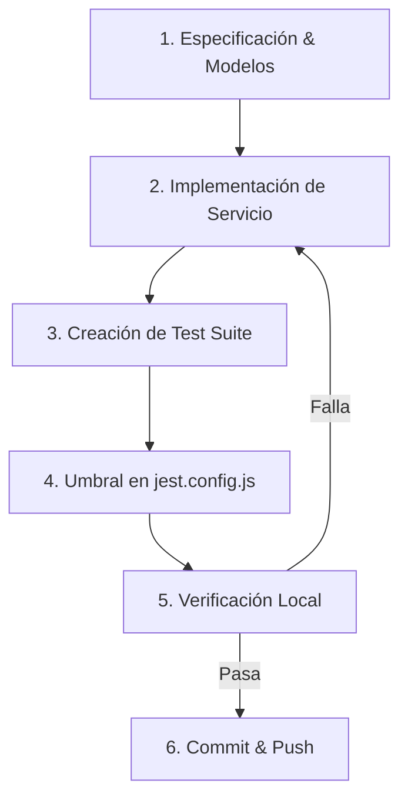

# Feature Quality & Testing Runbook - ResiGest 360

Este documento define el procedimiento operativo estándar obligatorio para el desarrollo, control de calidad y validación de cualquier nueva característica (feature) o refactorización en el proyecto **ResiGest 360**.

---

## 1. Principios de Calidad No Negociables

1. **Aislamiento Multi-Tenancy Estricto**:
   - Todo servicio que consulte o modifique datos en Supabase debe obtener el contexto del usuario/empresa mediante `getTenantContext()` o filtros `user_id` / `company_id`.
   - Ninguna consulta a tablas compartidas debe omitir el filtrado por pertenencia al tenant.
2. **Cobertura de Pruebas Unitarias**:
   - **Mínimo 80%** en todas las métricas (**Statements**, **Branches**, **Functions**, **Lines**) para cualquier nuevo servicio o módulo validado.
   - El umbral global del backend debe mantenerse o incrementarse respecto al baseline actual (>= 50%).
3. **Cero Errores de Tipado**:
   - TypeScript en modo estricto (`tsc --noEmit`). No se permite el uso de `any` injustificado o casts inseguros.
4. **Cero Advertencias de Linter**:
   - El código debe cumplir `eslint.config.mjs` sin suppressions no justificadas.
5. **Verificación Previa a Commit/Push**:
   - Antes de dar por finalizada la tarea o hacer `git push`, deben pasar `npm run typecheck`, `npm run lint` y `npm run test:ci`.

---

## 2. Flujo de Trabajo para Cada Nueva Feature



### Paso 1: Definición de Tipos e Interfaces
- Definir las interfaces en `src/types/` (ej. [src/types/wasteManagement.ts](file:///c:/Users/Alfredo/Desktop/resigest_360/src/types/wasteManagement.ts)).
- Asegurar que los formularios y payloads tengan definidos todos sus campos obligatorios y opcionales.

### Paso 2: Implementación de la Lógica de Negocio
- Ubicar la lógica en `src/services/<serviceName>.ts` o `src/lib/validations/<validationName>.ts`.
- Exportar tanto el objeto de servicio como las funciones auxiliares de cálculo y validación.
- Incluir manejo explícito de errores (`try/catch` con relanzamiento de errores descriptivos).

### Paso 3: Suite de Pruebas Unitarias
- Ubicar el archivo de pruebas en `src/services/__tests__/<serviceName>.test.ts`.
- Cubrir:
  - Casos exitosos (*happy path*).
  - Casos de error de autenticación (`user === null`).
  - Fallos en consultas a Supabase / Storage / APIs externas (Holded, etc.).
  - Filtros multi-tenancy (verificar cláusulas `.or()`, `.eq()`, `.in()`).
  - Validaciones de formato, fechas y transiciones de estado.

### Paso 4: Registro y Umbral en Jest
- Añadir el nuevo archivo al array `collectCoverageFrom` en [jest.config.js](file:///c:/Users/Alfredo/Desktop/resigest_360/jest.config.js).
- Configurar el umbral del 80% en `coverageThreshold`:
  ```javascript
  './src/services/<serviceName>.ts': {
    branches: 80,
    functions: 80,
    lines: 80,
    statements: 80
  }
  ```

### Paso 5: Suite de Validación Local
Ejecutar los tres comandos obligatorios:
```bash
# 1. Comprobación estricta de tipos
npm run typecheck

# 2. Análisis estático de código
npm run lint

# 3. Ejecución de tests con validación de cobertura
npm run test:ci
```

---

## 3. Patrón Estándar para Mocks en Jest

Para servicios que interactúan con Supabase, seguir el patrón probado en el proyecto:

```typescript
// 1. Mock de Supabase Client
const mockSupabase = {
  auth: {
    getUser: jest.fn(),
  },
  from: jest.fn(),
  storage: {
    from: jest.fn(() => ({
      upload: jest.fn(),
      getPublicUrl: jest.fn(),
    })),
  },
};

jest.mock('@/lib/supabase/client', () => ({
  createClient: () => mockSupabase,
}));

// 2. Helpers para encadenamiento de Supabase Query Builder
const createQueryChain = (resolvedData: any, error: any = null) => ({
  select: jest.fn().mockReturnThis(),
  eq: jest.fn().mockReturnThis(),
  or: jest.fn().mockReturnThis(),
  order: jest.fn().mockReturnThis(),
  single: jest.fn().mockResolvedValue({ data: resolvedData, error }),
  maybeSingle: jest.fn().mockResolvedValue({ data: resolvedData, error }),
});
```

---

## 4. Checklist de Aceptación para Pull Requests

Antes de solicitar revisión o fusionar a `development` / `main`:
- [ ] ¿El nuevo código tiene una suite de pruebas en `__tests__`?
- [ ] ¿La cobertura del nuevo módulo supera el 80% en statements, branches, funcs y lines?
- [ ] ¿El archivo fue incluido en [jest.config.js](file:///c:/Users/Alfredo/Desktop/resigest_360/jest.config.js) con su threshold correspondiente?
- [ ] ¿`npm run typecheck` termina con código de salida 0?
- [ ] ¿`npm run lint` termina sin advertencias ni errores?
- [ ] ¿`npm run test:ci` pasa todos los tests?
- [ ] ¿Los hooks de `.husky` (`pre-push`) están activos y pasan con éxito?
