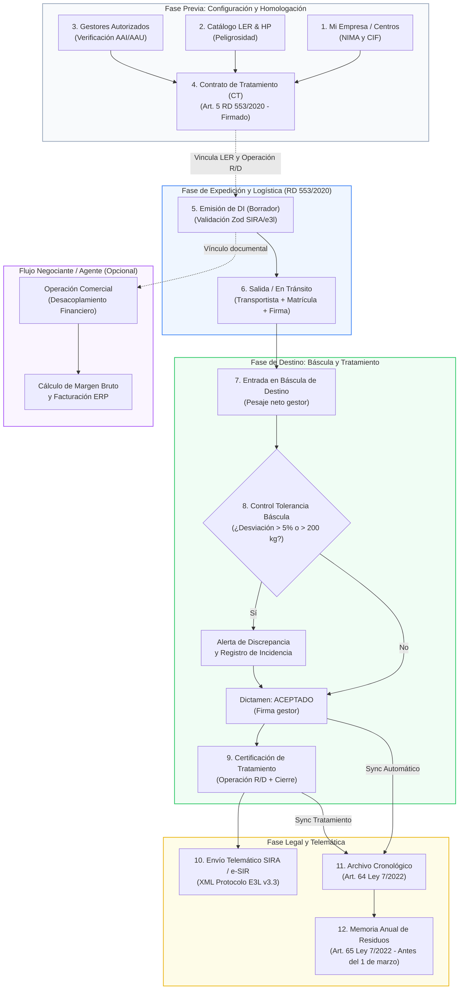

# Manual Integral de Módulos y Cumplimiento Legal de Resigest360

---

## 0. Acceso a la Plataforma y Credenciales de Administrador

Para acceder a la plataforma con el usuario administrador:
- **URL de Acceso:** `http://localhost:3000/signin`
- **Correo Electrónico:** `alfredobape@gmail.com`
- **Contraseña:** `AdminResigest2026!` *(Nota: Respetar mayúsculas en `A` y `R`, y el signo `!` final)*.
*(Verificado contra Supabase Auth: usuario activo con rol de administrador).*

---

## 1. Guía Detallada de Cada Apartado del Menú

A continuación se detalla la funcionalidad, utilidad operativa y campos obligatorios de cada una de las secciones del menú lateral de **Resigest360**.

---

### 1.1. Modo Admin / Empresas (`/platform-admin`)
* **¿Qué hace?**: Es la consola global para superadministradores de la plataforma. Permite visualizar todas las empresas registradas en el sistema, conmutar ("impersonar") la vista de cualquier empresa para auditar sus datos o prestar asistencia técnica sin requerir sus contraseñas, gestionar altas de empresas y revisar métricas globales de uso.
* **¿Para qué sirve?**: Permite a despachos de asesoría medioambiental o gestores multicuenta administrar decenas de clientes productores o plantas gestoras desde un único panel centralizado con aislamiento seguro de datos (RLS en Supabase).
* **Campos Obligatorios**:
  * **Nombre / Razón Social** de la empresa cliente.
  * **CIF / NIF** de la empresa cliente.
  * **Rol asignado** a los administradores (`admin` / `user`).

---

### 1.2. Dashboard (`/app`)
* **¿Qué hace?**: Panel principal analítico en tiempo real. Agrupa los indicadores clave de rendimiento (KPIs) del ejercicio:
  * Toneladas totales gestionadas (diferenciando residuos peligrosos y no peligrosos).
  * Estado en vivo de traslados (En Tránsito, En Báscula, Aceptados, Incidencias y Tratados).
  * Alertas de discrepancias de peso superiores a la tolerancia legal (>5% o >200 kg).
  * Contratos vigentes próximos a expirar.
  * Registro de actividad reciente y avisos de auditoría telemática SIRA.
* **¿Para qué sirve?**: Ofrece visibilidad inmediata al Director Medioambiental o Jefe de Planta sobre el estado de cumplimiento normativo y logístico de la empresa, evitando sanciones por plazos vencidos o traslados sin documentar.
* **Campos Obligatorios**:
  * No aplica formulario de creación directa (pantalla de visualización con filtros por ejercicio/año y centro de producción).

---

### 1.3. Mi Empresa (`/residuos/mi-empresa`)
* **¿Qué hace?**: Configura la identidad legal, fiscal y medioambiental de la empresa titular de la cuenta. Permite dar de alta:
  * Datos fiscales y domicilios (social y de instalación).
  * **NIMA (Número de Identificación de Medio Ambiente)** oficial otorgado por la Comunidad Autónoma.
  * **Centros de Producción secundarios**: cada planta, fábrica o nave con su propio NIMA y dirección.
  * **Credenciales telemáticas oficiales**: usuario y contraseña para transmisión telemática a **SIRA** (Junta de Andalucía) o **e-SIR** (Ministerio para la Transición Ecológica).
  * **Integración ERP contable**: API Key de Holded.
* **¿Para qué sirve?**: Es el pilar legal del sistema. Cualquier Documento de Identificación (DI), Contrato de Tratamiento o Memoria Anual requiere el NIMA y CIF de la empresa para ser válido ante la administración.
* **Campos Obligatorios**:
  * **Razón Social** (Nombre mercantil completo).
  * **CIF / NIF** (Válido para la Agencia Tributaria).
  * **NIMA** (10 dígitos emitido por Medio Ambiente).
  * **Tipo de Empresa** (`productor`, `gestor`, `transportista`, `negociante`, `agente`).
  * **Domicilio Social / Instalación** (Calle, número, código postal, municipio y provincia).
  * *En centros de producción:* Nombre del centro, NIMA específico del centro y dirección física.

---

### 1.4. Empresas y Contactos (`/residuos/empresas`)
* **¿Qué hace?**: Libreta de contactos y directorio unificado de terceros intervinientes en el ciclo del residuo. Permite asignar múltiples roles a un mismo tercero (un cliente puede ser productor y a la vez proveedor, o un gestor puede actuar como transportista).
* **¿Para qué sirve?**: Centraliza la información mercantil y medioambiental de proveedores de residuos, clientes receptores, gestores de tratamiento y transportistas, facilitando el autorrellenado en contratos y DIs.
* **Campos Obligatorios**:
  * **Razón Social**.
  * **CIF / NIF**.
  * **Roles Asignados** (al menos un rol: `productor`, `gestor`, `transportista`, `negociante`, `agente`, `cliente`, `proveedor`).
  * **NIMA** (imprescindible si el contacto interviene en traslados reglados).

---

### 1.5. Contratos de Tratamiento (`/residuos/contratos`)
* **¿Qué hace?**: Formaliza, custodia y valida los **Contratos de Tratamiento (CT)** entre el operador del traslado (productor/poseedor) y el destinatario (gestor de la instalación de tratamiento), conforme al **Artículo 5 del Real Decreto 553/2020**.
  * Vincula códigos LER autorizados con las operaciones de tratamiento específicas (R/D).
  * Incorpora tarifas de gestión y estimación de toneladas anuales.
  * Permite la **firma electrónica pública sin registro**: genera un enlace con token criptográfico para que la contraparte firme en pantalla desde cualquier dispositivo móvil o PC.
* **¿Para qué sirve?**: Ningún residuo puede salir legalmente de una instalación en España sin disponer previamente de un contrato de tratamiento en vigor. Resigest360 bloquea la emisión de DIs si no existe contrato previo válido.
* **Campos Obligatorios**:
  * **Empresa Productora / Poseedora**.
  * **Empresa Gestora / Destinatario**.
  * **Fecha del Contrato** y **Fecha de Vigencia / Vencimiento**.
  * **Tipo de Contrato** (`tratamiento`, `recogida`, `transporte`, `valorización`, `eliminación`).
  * **Líneas de Residuos**: Código LER (ej. `15 01 01`), descripción y Operación de Tratamiento RD (ej. `R03`, `R13`, `D10`).
  * **Estado** (`borrador`, `vigente`, `finalizado`, `cancelado`).

---

### 1.6. Gestores (`/residuos/gestores`)
* **¿Qué hace?**: Catálogo específico de instalaciones y gestores de valorización y eliminación. Registra:
  * Número de Autorización Ambiental (AAI / AAU).
  * NIMA del gestor.
  * Códigos LER que tiene legalmente autorizados recibir en sus instalaciones.
  * Operaciones de tratamiento permitidas en su resolución ambiental.
* **¿Para qué sirve?**: Impide que la empresa entregue residuos a plantas no autorizadas, lo cual constituiría una infracción muy grave según el Art. 108 de la Ley 7/2022. Resigest360 valida en tiempo real si el gestor seleccionado tiene potestad para el LER y la operación R/D antes de emitir un traslado.
* **Campos Obligatorios**:
  * **Razón Social**.
  * **CIF**.
  * **NIMA de Gestor**.
  * **Número de Autorización Ambiental**.
  * **Dirección, Municipio y Provincia** de la planta.
  * **Códigos LER autorizados** vinculados.

---

### 1.7. Transportistas (`/residuos/transportistas`)
* **¿Qué hace?**: Administra la flota de transporte de residuos autorizados. Registra transportistas públicos o autónomos con sus números de inscripción como transportistas de residuos y las matrículas de los vehículos habilitados.
* **¿Para qué sirve?**: Permite acreditar documentalmente el traslado ante agentes de tráfico (Guardia Civil / Seprona) o inspectores ambientales, garantizando que el transportista dispone de NIMA de transportista y vehículo consignado en el DI.
* **Campos Obligatorios**:
  * **Razón Social**.
  * **CIF**.
  * **NIMA de Transportista**.
  * **Matrícula del Vehículo principal**.
  * **Número de Autorización de Transporte**.

---

### 1.8. Documentos de Identificación (DI) (`/residuos/documentos-identificacion`)
* **¿Qué hace?**: Es el núcleo operativo de la plataforma para el cumplimiento del **RD 553/2020**. Gestiona el ciclo de vida completo de cada porte de residuos a través de un pipeline visual de 5 etapas:
  1. **Registrado / Borrador**: Selección de perspectiva (como Productor emisor o como Gestor receptor con carga de cliente), validación contra autorización de destino y validación de esquema SIRA.
  2. **En Tránsito**: Registro de salida con transportista, matrícula, fecha/hora y peso estimado en origen.
  3. **Pesaje en Báscula de Destino**: Registro del peso neto verificado en la báscula de entrada del gestor, número de albarán y ticket de pesada.
  4. **Dictamen del Gestor**: Aceptación o Rechazo (parcial/total con causa reglamentaria). Cálculo automático de discrepancia en kg y porcentaje de tolerancia.
  5. **Tratamiento y Cierre**: Asignación de la operación R/D ejecutada y fecha de tratamiento.
  * **Generación de PDF Oficial**: Modelo estandarizado conforme al anexo del RD 553/2020 con códigos de barras y casillas de pesaje.
  * **Integración Telemática**: Generación de archivo XML en formato E3L v3.3 y transmisión directa a la plataforma SIRA / e-SIR.
* **¿Para qué sirve?**: Es el salvoconducto obligatorio que ampara el traslado de cualquier residuo en España desde su origen hasta su destino final. Sustituye a los antiguos DCS (Documentos de Control y Seguimiento).
* **Campos Obligatorios**:
  * **Número de Documento** (NIMA + Año + Secuencia correlativa de 7 cifras).
  * **Fecha del Documento**.
  * **Productor/Origen**: Razón Social, CIF, NIMA, Dirección, Municipio y Provincia.
  * **Gestor/Destino**: Razón Social, CIF, NIMA, Número de Autorización, Dirección, Municipio y Provincia.
  * **Transportista**: Razón Social, CIF, NIMA y Matrícula.
  * **Residuo**: Código LER (6 dígitos), Peligrosidad (`no-peligroso` / `peligroso *`), Estado Físico (`solido`, `liquido`, `pastoso`, `gaseoso`), Cantidad y Unidad (`kg` o `toneladas`).
  * **En Báscula Receptora**: Peso verificado en báscula (`peso_destino_kg`) y Dictamen (`aceptado`, `rechazado_parcial`, `rechazado_total`).
  * **En Cierre**: Operación de Tratamiento R/D y fecha de tratamiento.

---

### 1.9. Operaciones Comerciales (`/residuos/operaciones`)
* **¿Qué hace?**: Diseñado específicamente para las figuras de **Negociante** y **Agente** reguladas en el **Artículo 23 de la Ley 7/2022**. Desacopla el flujo físico del residuo (que viaja de origen a destino con su propio DI) del flujo económico y mercantil.
  * Compra de residuos (coste por tonelada, flete, proveedor).
  * Venta de residuos (precio venta por tonelada, cliente gestor).
  * Cálculo de margen bruto total y margen por tonelada en tiempo real.
  * Control de estados de facturación y cobro.
* **¿Para qué sirve?**: Permite a intermediarios comerciales de chatarra, papel, cartón o plásticos llevar la trazabilidad económica y documental exigida por ley sin interferir en la logística física.
* **Campos Obligatorios**:
  * **Número de Operación**.
  * **Fecha**.
  * **Código LER** y **Cantidad en toneladas**.
  * **Proveedor / Origen comercial** y **Precio de compra**.
  * **Cliente / Destino comercial** y **Precio de venta**.
  * **Estado de la operación** (`borrador`, `abierta`, `en_transito`, `completada`, `liquidada`).

---

### 1.10. Archivo Cronológico (`/residuos/archivo-cronologico`)
* **¿Qué hace?**: Libro de registro digital regulado por el **Artículo 64 de la Ley 7/2022**. Registra cronológicamente y sin posibilidad de alteración:
  * Entradas y recepciones en planta gestora (`entrada_recepcion`).
  * Salidas y traslados de residuos (`salida_traslado`).
  * Generaciones de residuo en proceso productivo (`produccion_interna`).
  * Tratamientos internos aplicados (`tratamiento_interno`).
  * Ajustes y mermas de báscula (`merma_ajuste`).
  * **Sincronización Automática**: Cada vez que un DI se acepta o completa, se genera automáticamente el asiento cronológico correspondiente con el peso exacto de báscula.
  * **Exportaciones**: Exportación oficial a CSV y Excel normalizado compatible con los formatos de inspección de las Comunidades Autónomas.
* **¿Para qué sirve?**: Cumple la obligación de conservar durante al menos 3 a 5 años la trazabilidad de todos los residuos generados o gestionados. Es el primer documento que solicita cualquier inspección de Medio Ambiente.
* **Campos Obligatorios por Asiento**:
  * **Número de Asiento** correlativo (`AS-YYYY-XXXXXX`).
  * **Fecha de la operación**.
  * **Tipo de Operación** (`produccion_interna`, `salida_traslado`, `entrada_recepcion`, `tratamiento_interno`, `merma_ajuste`).
  * **Código LER** y **Descripción oficial del residuo**.
  * **Peligrosidad** y **Estado Físico**.
  * **Cantidad en kilogramos** (y toneladas equivalentes).
  * **NIF y Razón Social de Origen** (o indicación de propio).
  * **NIF y Razón Social de Destino** (si es salida o entrada).
  * **NIF, Razón Social y Matrícula del Transportista** (si hubo traslado).
  * **Operación R/D** de valorización o eliminación.
  * **Referencia Documental** (Número de DI o número de albarán del gestor).

---

### 1.11. Memorias Anuales (`/residuos/memorias-anuales`)
* **¿Qué hace?**: Generador de la **Memoria Anual de Residuos** exigida por el **Artículo 65 de la Ley 7/2022**.
  * Agrega automáticamente todos los DIs y movimientos del ejercicio finalizado (del 1 de enero al 31 de diciembre) para cada centro de producción.
  * Genera el desglose obligatorio por código LER, origen, destino y operación de valorización/eliminación.
  * Permite generar memorias específicas para: **Productor**, **Gestor (entradas y salidas)**, **Gestor RAEE**, **Negociante**, **Transportista** y **Agente**.
  * **Exportación normalizada**: Genera hojas de cálculo en formato Excel compatible con las plantillas del MITERD (Ministerio para la Transición Ecológica) y las Consejerías de Medio Ambiente autonómicas.
* **¿Para qué sirve?**: Automatiza la presentación que obligatoriamente debe presentarse antes del **1 de marzo de cada año** ante la autoridad ambiental competente. Un trámite que manualmente lleva semanas se genera en segundos sin riesgo de discrepancias con los DIs emitidos.
* **Campos Obligatorios**:
  * **Empresa y Centro de Producción** (con NIMA).
  * **Año / Ejercicio fiscal**.
  * **Tipo de Memoria** (`productor`, `gestor`, `negociante`, etc.).
  * **Número de Memoria correlativo** (`MA-YYYY-TIPO-XXX`).

---

### 1.12. Integraciones y Auditoría (`/residuos/integraciones`)
* **¿Qué hace?**: Módulo de conectividad externa y seguridad:
  * **SIRA / e-SIR / e3l**: Estado de las credenciales de conexión con la pasarela telemática de la administración pública.
  * **Holded ERP**: Conexión bidireccional para facturación automática de fletes y tratamientos.
  * **Log de Auditoría**: Registro inmutable de cada acción de usuario (creación de DI, modificación de pesajes, firmas, transmisiones y eliminaciones) con marca de tiempo, usuario y dirección IP.
* **¿Para qué sirve?**: Garantiza la integridad y no repudio de la información ante auditorías internas, certificaciones ISO 14001 o inspecciones administrativas.
* **Campos Obligatorios**:
  * Credenciales de acceso de la API o servicio correspondiente.

---

### 1.13. Soporte y Manual (`/support`)
* **¿Qué hace?**: Centro de ayuda contextual y soporte técnico con preguntas frecuentes sobre normativa medioambiental (RD 553/2020, Ley 7/2022), manuales de uso y canal directo de contacto para incidencias o dudas operativas.
* **¿Para qué sirve?**: Resuelve dudas operativas en planta o despacho durante la confección de documentos.

---

## 2. Diagrama de Flujo del Ciclo de Vida del Residuo

El siguiente diagrama ilustra cómo interactúan los diferentes módulos de Resigest360 a lo largo de todo el ciclo de gestión:

---

## 3. Resumen Ejecutivo: ¿Por qué Resigest360 cumple con la Legislación de Residuos?

Resigest360 ha sido diseñado y estructurado desde su núcleo de base de datos hasta su interfaz de usuario para dar **cumplimiento exhaustivo a la legislación española y europea en materia de residuos y economía circular**:

### 1. Cumplimiento del Real Decreto 553/2020 (Traslados de Residuos)
* **Contrato de Tratamiento previo obligatorio (Art. 5):** La plataforma impide la expedición de Documentos de Identificación sin la existencia previa de un contrato firmado entre el operador y el gestor destinatario.
* **Documento de Identificación estandarizado (Art. 6 y 7):** Genera el DI oficial en formato PDF normalizado y fichero digital, identificando con precisión matemática a los cuatro intervinientes: Productor, Transportista, Destinatario y Negociante/Agente si aplica.
* **Control de Báscula y Discrepancias (Art. 6.3):** Incorpora el cálculo automático de discrepancias entre el peso estimado en origen y el peso neto comprobado en la báscula de destino, alertando cuando supera el margen legal de tolerancia del 5% o 200 kg.
* **Plazo de Dictamen y Cierre:** Facilita la notificación de aceptación o rechazo y la posterior certificación del tratamiento de valorización o eliminación.

### 2. Cumplimiento de la Ley 7/2022 (Residuos y Suelos Contaminados para una Economía Circular)
* **Archivo Cronológico Telemático (Art. 64):** Mantiene un registro informático cronológico, continuo e inalterable de todas las operaciones (generaciones, traslados, recepciones en planta y operaciones de tratamiento R/D), garantizando la custodia de la información durante el plazo legal obligatorio de 3 a 5 años.
* **Memoria Anual de Gestores y Productores (Art. 65):** Genera de forma automatizada las declaraciones anuales consolidadas por centro, LER y destino antes del 1 de marzo, con exportación a las hojas de cálculo oficiales requeridas por el Ministerio (MITERD) y las CCAA.
* **Obligaciones de Negociantes y Agentes (Art. 23):** Modela específicamente la intermediación sin posesión física del residuo, manteniendo el desacoplamiento mercantil del traslado físico.

### 3. Estandarización Técnica Telemática (Protocolo E3L v3.3 y SIRA / e-SIR)
* Los documentos se estructuran siguiendo las especificaciones del **Estándar E3L v3.3** (Lenguaje Electrónico de Medio Ambiente para Residuos), lo que permite la transmisión directa mediante servicios web telemáticos a plataformas autonómicas (como **SIRA** en Andalucía) y estatales (**e-SIR**), cerrando el círculo de la tramitación 100% digital sin papeles.

---

## 4. Aspectos a Mejorar, Posibles Bugs y Hoja de Ruta Técnica

Para mantener la excelencia operativa, la robustez legal y la escalabilidad del sistema, se han identificado las siguientes áreas de optimización, posibles riesgos o *edge cases* y propuestas de mejora:

### 4.1. Aspectos Regulatorios y Funcionales a Mejorar

1. **Módulo Dedicado para Notificación Previa de Traslado (NT - Art. 8 RD 553/2020)**:
   * *Situación actual:* El DI cuenta con un selector `tipo_notificacion: 'con-notificacion-previa' | 'sin-notificacion'`.
   * *Mejora recomendada:* Crear una entidad autónoma de **Notificación Previa (NT)** con su propio número de acuse telemático (ej. formato e-SIR o autonómico), control de la **antelación obligatoria de 10 días naturales** antes del primer traslado y cómputo de la **vigencia máxima de 3 años**. Cada DI emitido bajo ese régimen debería vincularse a la NT matriz.

2. **Soporte Completo para DIs Multirresiduo (Múltiples líneas LER por albarán)**:
   * *Situación actual:* Aunque en el esquema de base de datos se preparó `migration-multi-residue-di.sql`, la interfaz de expedición de DIs sigue enfocada en 1 código LER por documento.
   * *Mejora recomendada:* En recogidas de mantenimiento, automoción o laboratorios, el transportista retira múltiples residuos en un único porte. Habilitar una tabla editable de líneas de residuo en el formulario agilizaría notablemente la operativa.

3. **Control del Plazo Máximo Legal de Almacenamiento Temporal (Art. 21 Ley 7/2022)**:
   * *Riesgo legal:* La ley prohíbe almacenar residuos peligrosos más de **6 meses** (1 año para no peligrosos con destino a eliminación, 2 años para valorización).
   * *Mejora recomendada:* Integrar un semáforo de antigüedad de acopio en el Archivo Cronológico / Stock temporal que alerte por correo y en el Dashboard cuando un residuo almacenado supere los 4 o 5 meses sin salida programada.

4. **Control de Cupo Máximo Anual Autorizado en Gestores**:
   * *Situación actual:* Se valida que el código LER y la operación R/D estén dentro del alcance de la autorización ambiental del destino.
   * *Mejora recomendada:* Incorporar el control cuantitativo: si la resolución ambiental del gestor autoriza un máximo de 500 toneladas anuales de un LER, el sistema debería alertar cuando la suma acumulada de DIs expedidos hacia esa planta se acerque a dicho límite.

5. **Expansión de Conectores Autonómicos más allá de SIRA**:
   * *Situación actual:* El conector SOAP/E3L está optimizado para **SIRA** (Junta de Andalucía) y e-SIR genérico.
   * *Mejora recomendada:* Desarrollar módulos adaptadores para otras CCAA con plataformas propietarias cerradas, tales como **GAIA** (Galicia), **SDR / ARC** (Cataluña), **IKS-eem** (País Vasco) o **ADCR** (Comunidad Valenciana).

---

### 4.2. Posibles Bugs, Riesgos Técnicos y Casos Límite (*Edge Cases*)

1. **Gestión de Errores de Conexión en Transmisiones SIRA (Reintentos y Timeout)**:
   * *Riesgo:* Si la sede electrónica de la administración sufre una caída temporal o bloqueo por alta demanda (habitual a finales de febrero antes de las memorias anuales), las peticiones síncronas en `siraService.ts` pueden quedar en espera indefinida.
   * *Solución recomendada:* Implementar una cola de envíos asíncrona (*background job / cron*) con reintentos exponenciales automáticos y trazabilidad de código HTTP de error.

2. **Cálculo de Memorias Anuales de Gran Escala**:
   * *Riesgo:* En clientes con más de 10.000 traslados anuales, el método `getDocumentosIdentificacionByYear` carga todos los registros en memoria del navegador antes de consolidar el resumen LER, lo que puede provocar bloqueos de la pestaña en dispositivos con pocos recursos.
   * *Solución recomendada:* Trasladar la agregación de tonelajes directamente a una consulta SQL / RPC (`SELECT codigo_ler, SUM(peso) GROUP BY codigo_ler`) en Supabase para obtener el resultado agregado en milisegundos.

3. **Validación de Formatos de Matrícula y Caracteres Especiales**:
   * *Riesgo:* Errores humanos al introducir matrículas con guiones, espacios o caracteres minúsculos pueden generar rechazos en el validador estricto del XSD de E3L (`e3l-waste.xsd`).
   * *Solución recomendada:* Aplicar una máscara de entrada y saneamiento automático (`.toUpperCase().replace(/[\s-]/g, '')`) en los campos de matrícula vehicular y CIF antes de guardar.

4. **Operativa sin Cobertura (Modo Offline para Transportistas)**:
   * *Riesgo:* Los transportistas a menudo operan en naves industriales, vertederos o zonas rurales sin cobertura móvil 4G/5G, lo que impide registrar la salida o recepción en ese instante.
   * *Solución recomendada:* Incorporar capacidades PWA (*Progressive Web App*) con almacenamiento local temporal (`IndexedDB`) para registrar la firma y pesaje offline y sincronizar en cuanto el dispositivo recupere señal.

5. **Firma Cualificada con Certificado Electrónico / Autofirma**:
   * *Riesgo:* La firma digital en pantalla (trazado táctil) es muy ágil para albaranes en planta, pero ante un litigio contencioso-administrativo o inspecciones muy exigentes, no equivale a una firma electrónica cualificada (eIDAS).
   * *Solución recomendada:* Añadir la opción de firmar documentos con certificado digital FNMT/DNIe mediante el cliente nativo Autofirma para usuarios que requieran fehaciencia legal plena.

---
*Documento generado para Resigest360 – Plataforma Integral de Gestión y Cumplimiento Normativo de Residuos.*
